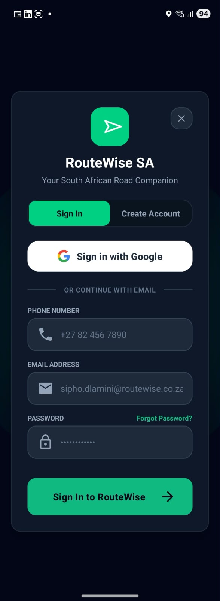
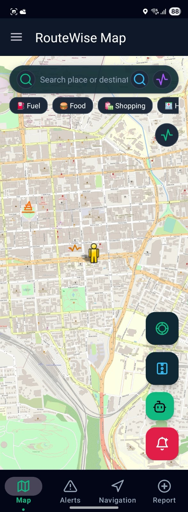
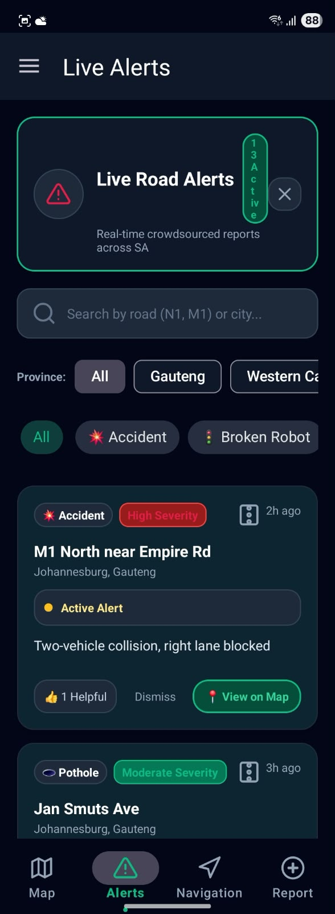
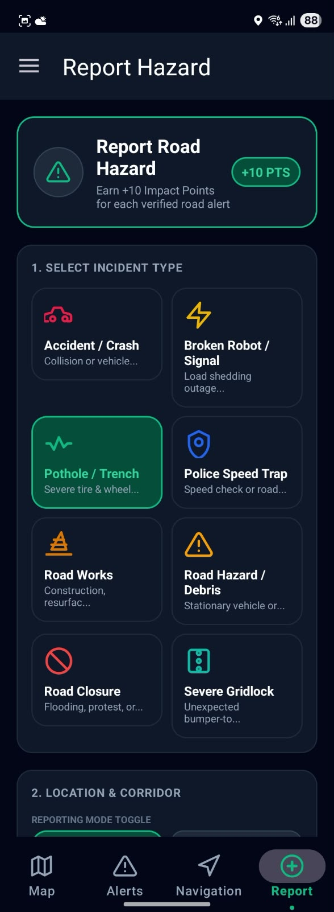

# RouteWise SA

[](https://github.com/OlugaNels/routewise-sa/actions/workflows/android-build.yml)

Real-time road alert Android app for Gauteng, South Africa. Built with Kotlin, Firebase Authentication and Firestore, Room, and OpenStreetMap.

**Purpose:** drivers report road hazards and see live alerts from other users on a map and in an alert feed. A companion website (Sentinel Command Center) lets an administrator monitor incidents, and both use the same Firebase project. The client is a road-safety non-profit that needs a platform that costs nothing to run, so every service used here has a free tier.

**Module:** XISD6329w | **Group 2** | Task 3: Final submission (version 1.2.0)

**Videos**
- Task 3 feature video (voice-over, all features, logging in Logcat): <!-- TODO: paste the unlisted YouTube link here once the Task 3 video is uploaded -->
- Task 2 demonstration video: https://youtu.be/6SSjHJxOnwA

## Screenshots

| Sign in | Map | Live alerts | Report a hazard |
|---|---|---|---|
|  |  |  |  |

## Team and contributions

RouteWise SA was built by Group 2 for module XISD6329w. Each member's role and contribution is listed below.

| Name | Student number | GitHub | Role | Contribution |
|---|---|---|---|---|
| Oluga Neluvhalani | ST10443034 | [@OlugaNels](https://github.com/OlugaNels) | Project Manager | Azure DevOps board, meeting minutes, user documentation and the final document. Brought the app and website together in this repository, added Firebase authentication, input validation, unit tests, the GitHub Actions workflow and the free hosting setup. In version 1.2.0: change password, working hazard alert switches, hazard notifications, logging, and release signing. |
| Neo Madima | ST10444163 | [@neomadima](https://github.com/neomadima), [@neomadima47-a11y](https://github.com/neomadima47-a11y) | Lead Developer | The Android app (Kotlin) and the Sentinel admin website with its API. The website's original repository is [Sentinel-Command-Center](https://github.com/neomadima47-a11y/Sentinel-Command-Center), and its commit history is part of this repository. |
| Mufhumudzi Rasilingwana | ST10441516 | [@mufhumudzi-rasilingwana](https://github.com/mufhumudzi-rasilingwana) | Database | Database design and records in Cloud Firestore, and the demonstration video. |
| Phathutshedzo Kevin Makherana | ST10438610 | [@st10438610](https://github.com/st10438610) | UX / Tester | Test cases, invalid input testing, testing on a physical phone, app screenshots and the final quality check. |

Neo Madima's original commits for the website are in this repository's history (see the commit "Merge the history of Neo Madima's Sentinel Command Center repository"). The commits on top of that were made while integrating and fixing the project.

## Live links

- Website and API (Render): https://routewise-sentinel.onrender.com (API example: `/api/incidents/live`). Render's free tier sleeps after 15 minutes, so the first request can take up to a minute.
- Android app download (APK): https://github.com/OlugaNels/routewise-sa/releases
- GitHub Actions: https://github.com/OlugaNels/routewise-sa/actions
- Firebase Hosting (static page only): https://routewisesa-fcde8.web.app
- User guide (PDF): [docs/RouteWise_SA_User_Guide.pdf](docs/RouteWise_SA_User_Guide.pdf)
- Release notes: [docs/RELEASE_NOTES.md](docs/RELEASE_NOTES.md)

## Features

- Register and log in with email and password (Firebase Authentication, passwords hashed by Firebase)
- Sign in with Google (single sign-on through Firebase)
- Forgot password by emailed reset link
- **Change password from Settings** (re-checks the current password first)
- Live map with hazard markers, alert feed and turn-by-turn route planning
- Report a road incident (type, road, severity, description)
- **Hazard alert switches** for accidents, police traps and roadworks that change what the map and feed show
- **Hazard notifications** when another driver reports a new hazard
- Edit profile (name, phone, vehicle, number plate)
- Settings (units, night map, voice guidance) saved on the device
- Input checks on every form so wrong input shows a message instead of crashing

## Design considerations

| Area | Decision | Reason |
|---|---|---|
| Cost | Only free tiers: Firebase Spark, OpenStreetMap, Render free, GitHub Actions | The client has no budget |
| Architecture | Activities and Fragments, a ViewModel per screen, repositories for data (`ui/`, `data/`) | Screens stay thin and the data code can be changed without touching the screens |
| Offline use | Incidents are cached in a Room database and refreshed from Firestore in real time | The app still shows the last known hazards when the signal drops |
| Security | Firebase Authentication handles passwords; Firestore rules limit each user to their own profile; the website admin password is stored hashed and logins are rate limited | No password is stored or logged by the app |
| Reliability | `InputValidator` checks every form on the JVM; Firestore reads skip a bad record instead of crashing | The brief asked for no crashes on invalid input |
| Testability | Logic with no Android classes (`InputValidator`, `HazardFilter`, `RouteTracker`, `NavigationText`) is unit tested | Tests run in seconds on GitHub Actions |
| Maps | osmdroid with OpenStreetMap data, OSRM for routes | Avoids a paid Google Maps key |
| Users | Dark theme, short messages, voice guidance | Used by drivers in a hurry |
| Logging | `android.util.Log` with one tag per class; no passwords, emails or device tokens are logged | Lets problems be traced in Logcat without leaking private data |

## How GitHub and GitHub Actions are used

- **Version control:** one repository holds the Android app, the Sentinel website and the documentation. Work was done in small commits with descriptive messages, and the website's full history was merged in, so each member's commits are visible.
- **Continuous integration:** `.github/workflows/android-build.yml` runs on every push and pull request to `main` (and can be started by hand). It checks out the code, installs Temurin JDK 17, sets up Gradle with caching, runs `./gradlew testDebugUnitTest`, builds the debug APK with `./gradlew assembleDebug`, and uploads the test report and the APK as downloadable artefacts. A failing test turns the commit red, so a broken build is seen straight away.
- **Status badge:** the badge at the top of this file shows the result of the latest run.
- **Releases:** each app version is published as a GitHub Release with an APK attached and release notes (see below).
- **Secrets:** the release keystore and its passwords are listed in `.gitignore` and are never committed.

## Release notes

Full notes: [docs/RELEASE_NOTES.md](docs/RELEASE_NOTES.md). The "prototype" is version 1.0.0, the build submitted for Task 2.

### Version 1.2.0 (final submission)

Innovative features added since the prototype:

| Feature | What it does |
|---|---|
| **Hazard notifications** | When another driver reports a new accident, police trap, roadwork or other hazard, the phone shows a heads-up notification that opens the map at that spot. Existing incidents are not announced when the app opens, and at most three notifications are shown at a time. Can be switched off in Settings. |
| **Hazard alert switches** | The Accident, Police and Roadwork switches (and the Live Hazard Layer switch) now change what is drawn on the map and listed in the Alerts feed straight away. In version 1.0.0 they only saved a value. |
| **Change password** | Settings, Account and Security. Checks the current password with Firebase, then saves the new one. Accounts created with Google show a note instead because they have no password. |
| **Settings shortcut to profile** | "Edit my profile" in Settings opens the profile screen. |
| **Logging** | Sign in, registration, route calculation, reporting, settings and notifications write events to Logcat. |
| **Signed release build** | `assembleRelease` produces a signed, shrunk APK that is ready for the Google Play Console. |

Changes and fixes:
- Removed the "Speed Warnings" switch. The app has no real speed-limit data, so the switch could not do anything honest.
- Notification code moved into one class (`AlertNotifications`) used by both push messages and in-app alerts.
- Push messages respect the Hazard Notifications switch.
- 15 more unit tests (76 in total).
- Version code 2, version name 1.2.0.

### Version 1.1.0 (map and navigation update)

- Clearer street map with sharper tiles, a satellite view and a night map after dark
- Real turn-by-turn text, ETA and distance
- Follows the GPS between steps and re-routes when the driver leaves the route
- Real distance and drive time on the place card
- Error messages instead of made-up routes

### Version 1.0.0 (Task 2 prototype)

Registration, login with email and Google, forgot password, live map, alerts feed, hazard reporting, settings, profile, Sentinel admin website, 32 unit tests and the GitHub Actions pipeline.

## Build and test

Requirements: JDK 17 or newer (Android Studio's bundled JDK works), Android SDK with platform 34.

```
./gradlew testDebugUnitTest   # run the unit tests (76 tests)
./gradlew assembleDebug       # build app/build/outputs/apk/debug/app-debug.apk
./gradlew assembleRelease     # signed release APK (needs keystore.properties, see below)
```

Every push runs the first two steps in GitHub Actions: see `.github/workflows/android-build.yml`.

### Release signing

Create a `keystore.properties` file next to `settings.gradle.kts` (it is ignored by Git):

```
storeFile=../signing/routewise-release.jks
storePassword=...
keyAlias=routewise
keyPassword=...
```

Without this file `assembleRelease` still builds, but the APK is unsigned.

## Firebase setup needed

1. Firebase console, Authentication, Sign-in method: enable **Email/Password** and **Google**.
2. Project settings, your Android app (`com.routewise.sa`): add the **SHA-1** of every key that signs an APK you install (your debug key, the one used by CI, and the release key), then download a fresh `google-services.json` into `app/`.

## Known limitations

- The Firestore rules for `incidents` and `notifications` are open to read and write, because the website and the app need to share them without a custom backend. A production version should require sign-in and check each write.
- Hazard notifications are shown while the app is running. Alerts to a closed app need Firebase Cloud Messaging topics sent from the Sentinel website.
- The speed-limit badge on the navigation screen is an estimate from the route length, not real road data.

## Layout

- `app/src/main/java/com/routewise/sa/` app source (`ui/`, `data/`, `service/`, `util/`)
- `app/src/test/` unit tests (`InputValidatorTest`, `HazardFilterTest`, `NavigationTextTest`, `RouteTrackerTest`)
- `website/` Sentinel Command Center admin website (Node.js server, Firebase)
- `.github/workflows/` GitHub Actions build and test workflow
- `docs/` user guide (PDF) and release notes
