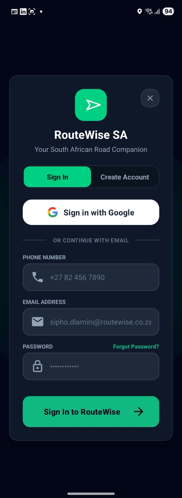
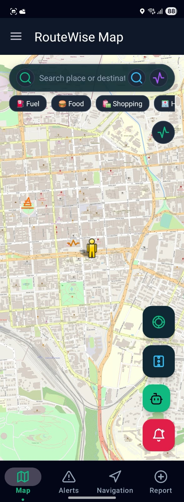
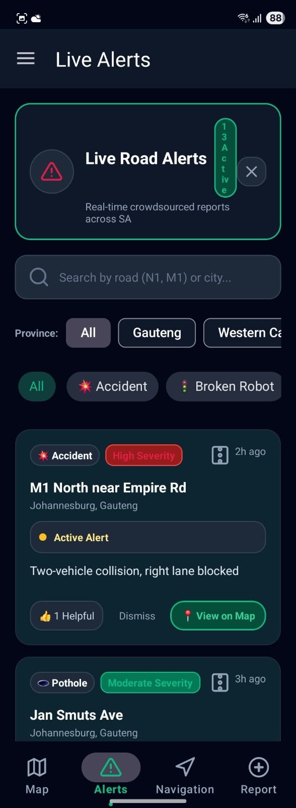
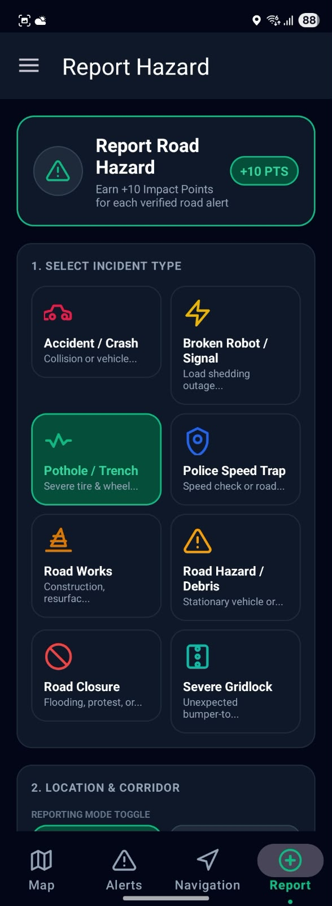

# RouteWise SA

[](https://github.com/OlugaNels/routewise-sa/actions/workflows/android-build.yml)

Real-time road alert Android app for Gauteng, South Africa. Built with Kotlin, Firebase Authentication and Firestore, Room, and OpenStreetMap.

**Purpose:** drivers report road hazards and see live alerts from other users on a map and in an alert feed. A companion website (Sentinel Command Center) lets an administrator monitor incidents, and both use the same Firebase project.

**Watch the demonstration video:** https://youtu.be/6SSjHJxOnwA

**Module:** XISD6329w | **Group 2** | Task 2: Mobile App Development

## Screenshots

| Sign in | Map | Live alerts | Report a hazard |
|---|---|---|---|
|  |  |  |  |

## Team and contributions

RouteWise SA was built by Group 2 for module XISD6329w. Each member's role and contribution is listed below.

| Name | Student number | GitHub | Role | Contribution |
|---|---|---|---|---|
| Oluga Neluvhalani | ST10443034 | [@OlugaNels](https://github.com/OlugaNels) | Project Manager | Azure DevOps board, meeting minutes, user documentation and the final document. Brought the app and website together in this repository, added Firebase authentication, input validation, unit tests, the GitHub Actions workflow and the free hosting setup. |
| Neo Madima | ST10444163 | [@neomadima](https://github.com/neomadima), [@neomadima47-a11y](https://github.com/neomadima47-a11y) | Lead Developer | The Android app (Kotlin) and the Sentinel admin website with its API. The website's original repository is [Sentinel-Command-Center](https://github.com/neomadima47-a11y/Sentinel-Command-Center), and its commit history is part of this repository. |
| Mufhumudzi Rasilingwana | ST10441516 | [@mufhumudzi-rasilingwana](https://github.com/mufhumudzi-rasilingwana) | Database | Database design and records in Cloud Firestore, and the demonstration video. |
| Phathutshedzo Kevin Makherana | ST10438610 | [@st10438610](https://github.com/st10438610) | UX / Tester | Test cases, invalid input testing, testing on a physical phone, app screenshots and the final quality check. |

Neo Madima's original commits for the website are in this repository's history (see the commit "Merge the history of Neo Madima's Sentinel Command Center repository"). The commits on top of that were made while integrating and fixing the project.

## Live links

- Website and API (Render): https://routewise-sentinel.onrender.com (API example: `/api/incidents/live`)
- Demonstration video (YouTube): https://youtu.be/6SSjHJxOnwA
- Demonstration video file (MP4, 17 MB): https://github.com/OlugaNels/routewise-sa/releases/download/v1.0-test/RouteWiseSA-Task2-Demonstration.mp4
- Android app download (APK): https://github.com/OlugaNels/routewise-sa/releases/tag/v1.0-test
- Firebase Hosting (static page only): https://routewisesa-fcde8.web.app
- GitHub Actions: https://github.com/OlugaNels/routewise-sa/actions
- User guide (PDF): [docs/RouteWise_SA_User_Guide.pdf](docs/RouteWise_SA_User_Guide.pdf)

## Features

- Register and log in with email and password (Firebase Authentication, passwords hashed by Firebase)
- Sign in with Google (single sign-on through Firebase)
- Forgot password by emailed reset link
- Live map, alert feed, route planning
- Report a road incident (type, road, severity, description)
- Settings (units and alert preferences) saved on the device
- Input checks on every form so wrong input shows a message instead of crashing

## Build and test

Requirements: JDK 17 or newer (Android Studio's bundled JDK works), Android SDK with platform 34.

```
./gradlew testDebugUnitTest   # run the unit tests
./gradlew assembleDebug       # build app/build/outputs/apk/debug/app-debug.apk
```

Every push runs both steps in GitHub Actions: see `.github/workflows/android-build.yml`.

## Firebase setup needed

1. Firebase console, Authentication, Sign-in method: enable **Email/Password** and **Google**.
2. Project settings, your Android app (`com.routewise.sa`): add the **SHA-1** of every key that signs an APK you install (your debug key, and the one used by CI if you install CI builds), then download a fresh `google-services.json` into `app/`.

## Layout

- `app/src/main/java/com/routewise/sa/` app source (`ui/`, `data/`, `util/`)
- `app/src/test/` unit tests (`InputValidatorTest`)
- `website/` Sentinel Command Center admin website (Node.js server, Firebase)
- `.github/workflows/` GitHub Actions build and test workflow
- `docs/` user guide (PDF)
